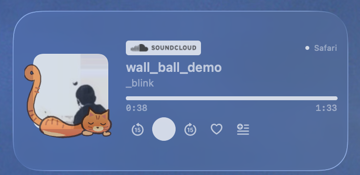
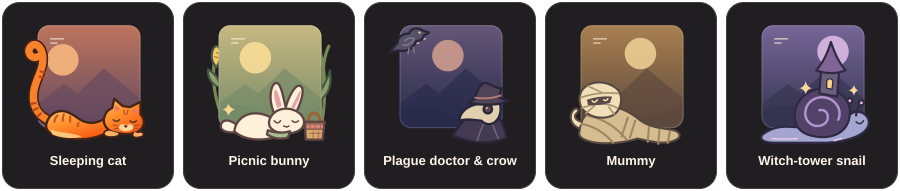

# Wolke

**A SoundCloud player for your macOS desktop.** See what's playing, switch tracks, and save favorites from a widget that fits beside your calendar and reminders.

[Download Wolke 1.8.1](https://github.com/leluxIceIce/Wolke/releases/download/v1.8.1/Wolke-1.8.1.zip) · [Release notes](https://github.com/leluxIceIce/Wolke/releases/tag/v1.8.1)



**Free beta** · Apple silicon · macOS 14 or later · Safari · [Apache 2.0](LICENSE)

## Playback

- **Now playing** shows the cover, track title, artist, elapsed time, and duration.
- **Transport controls** play or pause, skip to the previous or next track, and jump back or forward 15 seconds.
- **Likes and playlists** let you toggle a like or open SoundCloud’s playlist chooser in Safari.
- **Safari handoff** can resume a track in a background tab when you close the original. It uses your existing SoundCloud session and requires autoplay permission for soundcloud.com.

## Three sizes

| Size | Layout |
| :--- | :--- |
| **1×1** | Compact cover and two rows of controls |
| **2×1** | Horizontal player with cover and controls side by side |
| **2×2** | Larger artwork and a full row of controls |

## Pick a mascot



Right-click a Wolke widget on the desktop and choose **Edit Widget → Figur**. Pick a mascot or select **Ohne Figur** to show the cover on its own. The sleeping cat is the default, and each widget can have a different mascot.

## Install

1. Download [Wolke-1.8.1.zip](https://github.com/leluxIceIce/Wolke/releases/download/v1.8.1/Wolke-1.8.1.zip), unzip it, move **Wolke.app** into **Applications**, and open it. Wolke runs in the menu bar. Use **Player anzeigen** (Show Player) there if you want its compact window.
2. In Safari, open **Settings → Advanced** and enable **Show features for web developers**. Under **Developer**, enable **Allow unsigned extensions** for this Safari session. This is a session-wide setting and Safari resets it when you quit. [Apple’s Safari setup guide](https://developer.apple.com/documentation/safariservices/running-your-safari-web-extension)
3. In **Safari → Settings → Extensions**, enable **Wolke**. Grant access to **soundcloud.com**. That permission also covers `soundcloud.com/discover`.
4. Reload your SoundCloud tab with **⌘R** and start a track. Right-click the desktop, choose **Edit Widgets**, and add **Wolke** in your preferred size.

Keep a single copy of Wolke in Applications and quit older copies before updating. The downloadable beta is signed to run locally. It is distributed outside the App Store and is not notarized.

## How it works

- **Use your existing SoundCloud session.** Wolke reads the player on SoundCloud pages. Your sign-in stays in Safari. The Safari extension and desktop widget exchange playback state and commands with the local Wolke app over loopback.
- **Close the source tab.** With **Allow All Auto-Play** enabled for SoundCloud, Wolke can try to resume a playing track at the last known position in a background Safari tab. Expect a short load on handoff. Quitting Safari ends playback.
- **Use the Safari toolbar too.** Click Wolke’s cat icon on a SoundCloud tab for a compact player in the browser. If the icon is hidden, add it through **View → Customize Toolbar**.

## Build from source

You need Xcode on an Apple silicon Mac. Select Xcode as the active developer directory, then run:

```sh
sh scripts/build.sh
```

The script creates a local bridge key on first build and leaves the verified archive in `dist/`. The key is ignored by Git. To work in Xcode, run the script once and then open `Wolke.xcodeproj`.

Run the browser-side tests with Node.js:

```sh
node Tests/player.test.cjs
node Tests/handoff.test.cjs
```

## License

Wolke’s source code and original mascot artwork are licensed under [Apache 2.0](LICENSE). See [NOTICE](NOTICE) for third-party materials.

Wolke is an independent companion app. The SoundCloud wordmark identifies the playback source. SoundCloud branding and the track artwork in the screenshot retain their respective rights. [SoundCloud attribution assets](https://developers.soundcloud.com/docs/api/buttons-logos)
